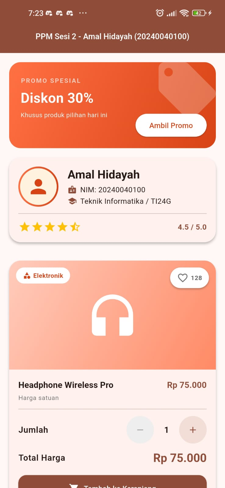

# Tugas 2 Flutter - Product & Profile (Widget)

Aplikasi Flutter sederhana untuk memenuhi tugas **PPM Sesi 2**. Aplikasi menampilkan **halaman profil mahasiswa** dan **kartu produk** interaktif dalam satu layar.

## Identitas

| | |
|---|---|
| **Nama** | Amal Hidayah |
| **NIM** | 20240040100 |
| **Prodi / Kelas** | Teknik Informatika / TI24G |

## Screenshot

| Tampilan Atas | Tampilan Produk |
|---|---|
|  |  |

## Fitur

- **AppBar** menampilkan `PPM Sesi 2 - Amal Hidayah (20240040100)`.
- **Tema warna** Deep Orange (`ColorScheme.fromSeed`) dengan Material 3.
- **Kartu Profil** (`StatelessWidget`): foto/ikon profil, nama, NIM, Prodi/Kelas, dan 5 ikon bintang (rating).
- **Banner Promo** menggunakan `Stack` + `Positioned`.
- **Kartu Produk** (`StatefulWidget`): gambar/placeholder produk, nama produk, harga, dan kategori.
- **Tombol Favorite**: ikon hati berubah saat ditekan, jumlah like bertambah/berkurang.
- **Pengatur jumlah** produk dengan tombol `-` dan `+` (jumlah minimal **1**).
- **Total harga** otomatis berubah sesuai jumlah produk.
- **Tombol Tambah ke Keranjang** yang menampilkan **SnackBar**.

## Widget yang Digunakan

`Scaffold`, `Row`, `Column`, `Container`, `Card`, `Stack`, `Positioned`, `Icon`, `Button` (`ElevatedButton` / `IconButton`), `StatelessWidget`, dan `StatefulWidget`.

Selain itu juga digunakan: `SingleChildScrollView`, `CircleAvatar`, `Divider`, `SnackBar`, `InkWell`, dan `Material`.

## Struktur Project

```
ppm_sesi_2/
├── lib/
│   └── main.dart          # Seluruh kode aplikasi
├── screenshots/
│   ├── screenshot_1.jpeg
│   └── screenshot_2.jpeg
├── test/
│   └── widget_test.dart   # Widget test
├── pubspec.yaml
└── README.md
```

## Cara Menjalankan

Pastikan Flutter sudah terpasang (`flutter doctor`), lalu:

```bash
# 1. Masuk ke folder project
cd ppm_sesi_2

# 2. Ambil dependency
flutter pub get

# 3. Jalankan di HP (USB) / emulator
flutter run
```

Menjalankan di HP yang tersambung USB:

```bash
flutter devices          # pastikan HP terdeteksi
flutter run -d <device_id>
```

## Pemeriksaan Kualitas

```bash
flutter analyze   # No issues found
flutter test      # All tests passed
```

Project dapat di-build menjadi APK:

```bash
flutter build apk --debug
```
